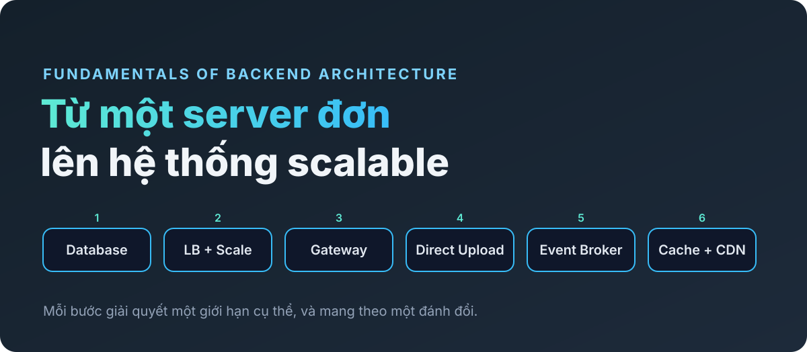

# Author : ChungHA

# Backend Architecture: 6 Steps from a Single Server to a Scalable System

A file storage app can start with exactly one server. It runs fine, users are happy, until load grows, the business logic swells, and you start asking: **where does the design need to change?**

This post is based on the video [Fundamentals of Backend Architecture](https://www.youtube.com/watch?v=Qa-7iWxDz1A) by Tiago. It uses a **Google Drive clone** as the example and walks through 6 steps. What I like about this approach is that every step starts from a concrete limit, solves it, and then tells you the price. No step is free.

The summary up front:

| Step | Limit hit | Solution | Trade-off |
|---|---|---|---|
| 1 | Metadata lives in RAM and is lost when the process dies | Shared relational DB | The DB becomes a single point of failure |
| 2 | One machine can't carry the traffic | Horizontal scaling + Load Balancer + Autoscaler | Higher cost, the DB is still the bottleneck |
| 3 | Many teams and domains; uploads starve lightweight requests | Split services + API Gateway | More operational complexity |
| 4 | Large file bytes flow through the app server | Direct Upload via Object Storage | Presigned URLs and policies to manage |
| 5 | Thumbnails, realtime and notifications slow down the main flow | Event Broker (pub-sub / queue) | Eventual consistency, retries and DLQ to handle |
| 6 | Repeated reads and abusive clients | Cache, CDN, Rate Limiting | Cache invalidation, more components to operate |

## Step 1: Escape the in-memory trap and separate the data layer

The first server keeps the `file ID → path` mapping in RAM. It's fast, but it has two problems:

- **When the process dies, the mapping is gone.** After a restart the files are still on disk, but nobody knows which file is which.
- **Adding more servers doesn't fix it.** A file written on node A is unknown to node B.

The fix is to move metadata into a **shared relational database**. Persistence is now separated from compute: the instances handling requests no longer hold state in the process, which makes them **stateless**. A restarted server can still look up the metadata.

**Trade-off:** a single database is now a shared point of failure. When the DB goes down, every request that needs it is interrupted.

## Step 2: Scale compute with a Load Balancer and an Autoscaler

When traffic exceeds one machine, we need more compute. Two directions:

- **Vertical scaling:** give the existing machine more CPU/RAM. Simple, but it hits a hardware ceiling and keeps everything on one node.
- **Horizontal scaling:** add more stateless replicas all pointing at the shared database. In practice the two are often combined, and both raise infrastructure cost.

With multiple replicas you need a **Load Balancer** to distribute requests, plus **health checks** to remove failing nodes from rotation (detection time depends on how the checks are configured). The choice of algorithm also depends on the workload:

- **Round Robin** distributes in turn. But the same number of requests doesn't mean the same cost: a heavy file upload is very different from a metadata read.
- **Weighted Round Robin** uses configured weights, useful when nodes differ in power.
- **Least Connections** prefers the node with the fewest active connections.
- **Sticky Sessions** try to send a user back to the same node to reuse local state. This is only best-effort: if the node fails, the request has to move elsewhere.

The **Autoscaler** watches load to add or remove instances, while the LB distributes requests across the instances that are running.

**Trade-off:** more compute only raises processing capacity. The shared database has its own limits and is very likely the next bottleneck.

## Step 3: Split domains, API Gateway and authentication at the edge

When file uploads start affecting lightweight requests, or several teams need to develop independently, we can split by domain: **Files, Auth, Notifications, Realtime, Thumbnail**. Microservices give you specialization, but operational complexity goes up noticeably. Don't split just because it sounds cool.

In the example, the services live inside a **VPC** with no public IPs. Clients go through an **API Gateway**, a single entry point that does two main things: routes requests and can aggregate data from multiple services. To keep the Gateway from becoming a single point of failure, run several Gateway instances behind a Load Balancer.

Authentication is also pushed to the edge:

- With **asymmetrically signed JWTs**, the Gateway verifies the signature with the **public key** and checks expiry right there, with no call to the Auth Service on every request. An invalid token gets **HTTP 401**.
- Responsibilities are clearly split: the Gateway handles **Authentication** (who you are), each service handles **Authorization** (what you may do with this resource).

## Step 4: Separate the heavy data flow with Direct Upload

Large files going through the application server eat bandwidth, stretch processing time and cause timeouts. Stuffing the bytes into the relational DB is even worse. The solution is to let **Object Storage** (S3, GCS, ...) receive the bytes directly from the client:

1. The client sends **metadata** (file name, size, format) to the API Gateway.
2. The **Files Service** saves a record to the database (the server assigns the ID) and asks Object Storage to create a short-lived **Presigned Upload URL**.
3. The server returns the URL to the client (HTTP 200). The client pushes the binary data **straight to the bucket**.

The app still manages metadata, but no longer carries the byte stream.

**Note:** a presigned URL grants upload permission to **anyone holding the link** while it's valid. If you want to limit size or content type, you need a matching policy supported by your provider. Don't assume it's there by default.

## Step 5: Handle side tasks asynchronously with an Event Broker

After an upload there's a pile of follow-up work: generating thumbnails, pushing realtime updates, sending notifications. Calling them synchronously makes the main flow depend on the speed and health of every downstream service. One slow service slows the whole request.

Put an **Event Broker** (pub-sub / message queue) in the middle to decouple the event producer from the consumers:

- Object Storage emits an "upload finished" event into the Broker, and consumers pick it up and process it **independently**.
- If thumbnail generation fails, the file just lacks a thumbnail. That failure **doesn't mean the upload must be rolled back**.
- Depending on the broker and configuration, the system can have durable storage, **ACK** to confirm successful processing, **retry** when processing hasn't succeeded, and a **Dead Letter Queue (DLQ)** for messages that keep failing, with alerts to Slack or Discord.

**Trade-off:** you give up the simplicity of a synchronous flow in exchange for fault tolerance, and you accept eventual consistency and the need to design idempotent consumers (retries mean the same message can arrive more than once).

## Step 6: Optimize reads with Cache, CDN and Rate Limiting

When many people read the same file, we cut repeated queries and traffic to the origin storage at two layers, while also dropping excess requests to protect resources.

**Cache-Aside with Redis for metadata.** Small, rarely changing information (file name, size, attributes) is kept in RAM. A read request checks the cache first: on a **cache hit** it returns immediately, on a **cache miss** it queries the DB and writes the result back into the cache. Note that a cache hit here only avoids a database query; the client still needs to fetch the file bytes.

**CDN for file bytes.** Static files are pulled into the CDN's **PoPs** (edge locations) after the first request (the cold request goes back to the origin). Later users nearby receive the file directly from the edge, with lower latency and less load on the origin.

**Rate Limiting.** Put a counter at the Gateway (or the edge layer) backed by a key-value store, counting per IP or User ID. For example, a limit of 10 requests/minute, and anything over the threshold gets **HTTP 429 Too Many Requests**.

**Trade-off:** caching means dealing with stale data (when to invalidate, what TTL), and the CDN and Redis are more components to operate and pay for.

## The core lesson

A scalable system doesn't come from stuffing in as much technology as possible from day one. It's built from **deliberate decisions**:

1. Start simple.
2. Understand your current limits (measure, don't guess).
3. Add components only when the need demands it.

Each separation of responsibilities solves one problem, but also creates extra cost and operational work. The right question isn't "what should we use" but "which limit is holding us back, and what price are we willing to pay to remove it".

And you: in the projects you've worked on, which bottleneck forced the team to change the architecture earliest: large file I/O, data synchronization across nodes, or asynchronous coordination through a message broker?
