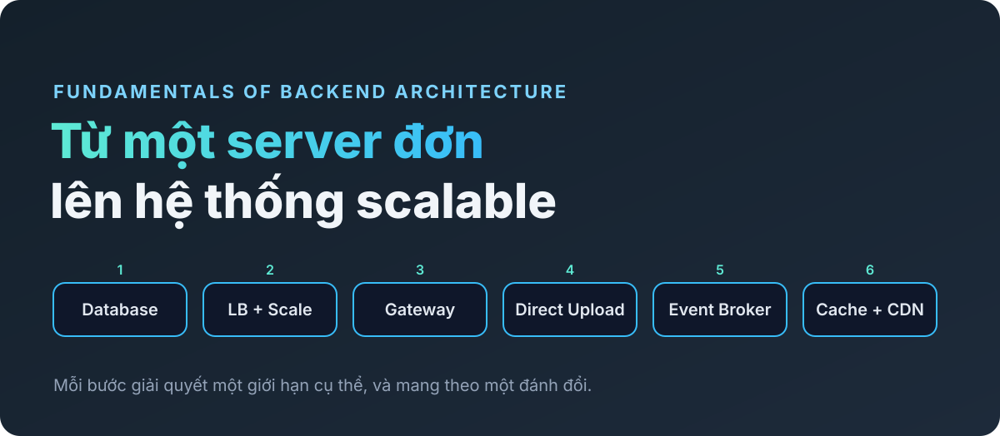

# Tác giả : ChungHA

# Backend Architecture: 6 bước từ một server đơn lên hệ thống scalable

Một ứng dụng lưu trữ file có thể bắt đầu bằng đúng một server. Chạy ngon, user hài lòng, cho tới khi tải tăng, nghiệp vụ phình ra, và bạn bắt đầu tự hỏi: **thiết kế cần thay đổi ở đâu?**

Bài này mình viết dựa trên video [Fundamentals of Backend Architecture](https://www.youtube.com/watch?v=Qa-7iWxDz1A) của Tiago, lấy ví dụ một con **Google Drive clone** và đi qua 6 bước. Điểm hay của cách kể này là mỗi bước đều bắt đầu từ một giới hạn cụ thể, giải quyết nó, rồi chỉ ra luôn cái giá phải trả. Không có bước nào là "miễn phí".

Tóm tắt trước cho anh em:

| Bước | Giới hạn gặp phải | Giải pháp | Trade-off |
|---|---|---|---|
| 1 | Metadata nằm trong RAM, chết process là mất | Relational DB dùng chung | DB thành single point of failure |
| 2 | Một máy không gánh nổi traffic | Scale ngang + Load Balancer + Autoscaler | Tốn chi phí, DB vẫn là điểm nghẽn |
| 3 | Nhiều team, nhiều domain, upload làm nghẽn request nhẹ | Tách service + API Gateway | Vận hành phức tạp hơn |
| 4 | Bytes của file lớn đi qua app server | Direct Upload qua Object Storage | Phải quản lý presigned URL và policy |
| 5 | Thumbnail, realtime, notification làm chậm luồng chính | Event Broker (pub-sub / queue) | Eventual consistency, phải xử lý retry và DLQ |
| 6 | Đọc lặp đi lặp lại, bị abuse | Cache, CDN, Rate Limiting | Cache invalidation, thêm thành phần để vận hành |

## Bước 1: Thoát khỏi bẫy in-memory, tách tầng dữ liệu

Server đầu tiên giữ bảng ánh xạ `file ID → đường dẫn` ngay trong RAM. Nghe thì nhanh, nhưng có hai vấn đề:

- **Process chết là mất mapping.** Restart xong, file vẫn nằm trên đĩa nhưng không ai biết nó là file nào.
- **Nhân bản thêm server cũng không giải quyết được.** File ghi ở node A thì node B không biết nó nằm đâu.

Cách xử lý là đưa metadata vào một **relational database dùng chung**. Lúc này persistence được tách khỏi compute: các instance xử lý request không còn giữ state trong process, tức là trở thành **stateless**. Server restart vẫn tra lại được metadata.

**Trade-off:** database đơn lẻ giờ là điểm lỗi chung. DB ngừng hoạt động thì mọi request cần DB đều bị gián đoạn.

## Bước 2: Scale compute với Load Balancer và Autoscaler

Khi traffic vượt quá một máy, ta cần thêm sức tính toán. Có hai hướng:

- **Vertical scaling:** tăng CPU/RAM cho máy hiện tại. Đơn giản, nhưng có trần phần cứng và vẫn dồn hết vào một node.
- **Horizontal scaling:** thêm nhiều replica stateless cùng trỏ về database chung. Thực tế hai hướng này thường được phối hợp, và cả hai đều làm tăng chi phí hạ tầng.

Có nhiều replica thì cần **Load Balancer** để chia request, kèm **health check** để loại node lỗi khỏi danh sách phục vụ (thời gian phát hiện phụ thuộc cấu hình kiểm tra). Chọn thuật toán cũng phải nhìn vào workload:

- **Round Robin** chia lần lượt. Nhưng cùng số request chưa chắc cùng chi phí: upload file nặng khác xa đọc metadata.
- **Weighted Round Robin** dùng trọng số cấu hình, hợp khi các node có sức mạnh khác nhau.
- **Least Connections** ưu tiên node đang có ít kết nối nhất.
- **Sticky Sessions** cố đưa user về node cũ để tận dụng state cục bộ. Đây chỉ là best-effort: node lỗi thì request vẫn phải chuyển sang node khác.

**Autoscaler** theo dõi tải để thêm/bớt instance, còn LB lo phân phối request tới các instance đang chạy.

**Trade-off:** thêm compute chỉ nâng được năng lực xử lý. Database dùng chung vẫn có giới hạn riêng, và rất dễ là chỗ nghẽn tiếp theo.

## Bước 3: Tách domain, API Gateway và xác thực tại biên

Khi upload file bắt đầu ảnh hưởng tới các request nhẹ, hoặc nhiều team cần phát triển độc lập, ta có thể tách theo domain: **Files, Auth, Notifications, Realtime, Thumbnail**. Microservices cho khả năng chuyên môn hoá, nhưng đổi lại độ phức tạp vận hành tăng rõ rệt. Đừng tách chỉ vì thấy hay.

Trong ví dụ, các service nằm trong **VPC** và không mở IP công khai. Client đi qua **API Gateway**, điểm vào thống nhất, làm hai việc chính: định tuyến request và có thể tổng hợp dữ liệu từ nhiều service. Để Gateway không biến thành single point of failure, chạy nhiều instance Gateway phía sau một Load Balancer.

Phần xác thực cũng được đẩy ra biên:

- Với **JWT ký bất đối xứng**, Gateway verify chữ ký bằng **public key** và kiểm tra thời hạn ngay tại chỗ, không cần gọi Auth Service cho mỗi request. Token không hợp lệ bị trả về **HTTP 401**.
- Phân vai rõ ràng: Gateway lo **Authentication** (bạn là ai), từng service lo **Authorization** (bạn được làm gì trên tài nguyên này).

## Bước 4: Tách luồng dữ liệu nặng bằng Direct Upload

File lớn đi qua application server sẽ ngốn băng thông, kéo dài thời gian xử lý và dễ gây timeout. Chưa kể nếu nhét bytes vào relational DB thì càng tệ. Giải pháp là để **Object Storage** (S3, GCS, ...) nhận bytes trực tiếp từ client:

1. Client gửi **metadata** (tên file, kích thước, định dạng) tới API Gateway.
2. **Files Service** lưu bản ghi vào database (server tự cấp ID), đồng thời nhờ Object Storage tạo một **Presigned Upload URL** có thời hạn ngắn.
3. Server trả URL về client (HTTP 200). Client đẩy dữ liệu nhị phân **thẳng lên bucket**.

App vẫn quản lý metadata, nhưng không còn phải gánh luồng bytes.

**Lưu ý:** presigned URL cấp quyền upload cho **bất kỳ ai giữ link** trong thời gian hiệu lực. Muốn giới hạn dung lượng hay content type thì cần policy tương ứng do provider hỗ trợ, đừng mặc định là có.

## Bước 5: Xử lý tác vụ phụ bất đồng bộ qua Event Broker

Sau upload còn cả đống việc: sinh thumbnail, đẩy realtime, gửi notification. Nếu gọi đồng bộ thì luồng chính phụ thuộc vào tốc độ và tình trạng của mọi service phía sau. Một service chậm là cả request chậm theo.

Chèn một **Event Broker** (pub-sub / message queue) vào giữa để tách bên phát sự kiện khỏi bên tiêu thụ:

- Object Storage phát sự kiện "upload xong" vào Broker, các consumer nhận và xử lý **độc lập**.
- Sinh thumbnail lỗi thì file chỉ thiếu ảnh thu nhỏ. Lỗi đó **không đồng nghĩa với việc upload phải rollback**.
- Tuỳ broker và cấu hình, hệ thống có thể có durable storage, **ACK** để xác nhận xử lý xong, **retry** khi chưa thành công, và **Dead Letter Queue (DLQ)** cho message lỗi kéo dài, kèm alert qua Slack hoặc Discord.

**Trade-off:** bạn đổi sự đơn giản của luồng đồng bộ lấy khả năng chịu lỗi, và phải chấp nhận eventual consistency cùng việc thiết kế consumer idempotent (vì retry nghĩa là cùng một message có thể tới nhiều lần).

## Bước 6: Tối ưu đọc với Cache, CDN và Rate Limiting

Khi nhiều người cùng đọc một file, ta giảm truy vấn lặp và lưu lượng về storage gốc ở hai tầng, đồng thời chặn bớt request thừa để bảo vệ tài nguyên.

**Cache-Aside với Redis cho metadata.** Thông tin nhỏ, ít đổi (tên file, kích thước, thuộc tính) được giữ trên RAM. Request đọc kiểm tra cache trước: **cache hit** thì trả luôn, **cache miss** mới query DB rồi ghi lại vào cache. Lưu ý cache hit ở đây chỉ tránh được query database, client vẫn cần lấy bytes của file.

**CDN cho file bytes.** File tĩnh được kéo về các **PoP** (edge) của CDN sau request đầu tiên (cold request đi về origin). Những user sau ở gần đó nhận file trực tiếp từ edge, độ trễ thấp hơn và origin đỡ tải.

**Rate Limiting.** Đặt bộ đếm ở Gateway (hoặc tầng edge) với một key-value store, đếm theo IP hoặc User ID. Ví dụ giới hạn 10 request/phút, vượt ngưỡng thì trả **HTTP 429 Too Many Requests**.

**Trade-off:** cache thì phải lo chuyện dữ liệu cũ (invalidate khi nào, TTL bao lâu); CDN và Redis đều là thêm thành phần để vận hành và trả tiền.

## Bài học cốt lõi

Một hệ thống scalable không sinh ra từ việc nhét thật nhiều công nghệ vào từ đầu. Nó được xây từ những **quyết định có chủ đích**:

1. Bắt đầu đơn giản.
2. Hiểu rõ giới hạn hiện tại (đo, đừng đoán).
3. Chỉ thêm thành phần khi nhu cầu đòi hỏi.

Mỗi lần tách trách nhiệm giải quyết được một vấn đề, nhưng cũng tạo thêm chi phí và công việc vận hành. Câu hỏi đúng không phải "nên dùng gì" mà là "giới hạn nào đang cản mình, và mình sẵn sàng trả giá gì để gỡ nó".

Còn anh em, trong các dự án đã làm, điểm nghẽn nào buộc team phải đổi kiến trúc sớm nhất: xử lý I/O file lớn, đồng bộ dữ liệu giữa các node, hay điều phối bất đồng bộ qua message broker?
