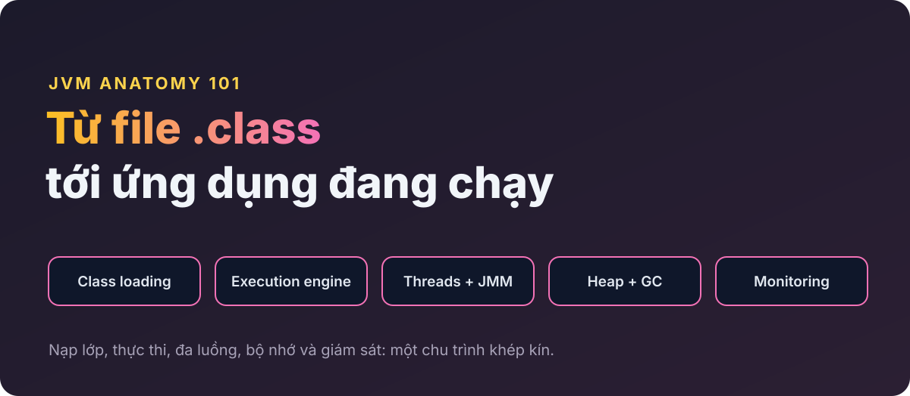
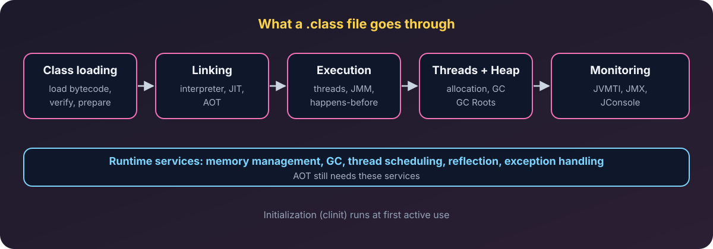

# Author : ChungHA

# JVM Anatomy 101: What Happens to a .class File Before It Becomes a Running Application



What steps does a `.class` file go through to become a running application? To answer that fully, a backend engineer needs to understand a closed loop across the JVM's subsystems:

**classloading / linking / initialization → execution engine → threads / allocation / GC → monitoring**

This post is based on the talk [JVM Anatomy 101](https://www.youtube.com/watch?v=BeMi8K0AFAc), published by JetBrains in 2023. The speaker is Nikita Lipsky, an engineer who worked on Excelsior JET, and he follows the Java Virtual Machine Specification throughout. Let's go through the 6 parts.



## 1. Class loading: the identity of a type

The **Classloading Engine** takes the byte array from a `.class` file and creates the corresponding type representation in runtime memory.

A commonly misunderstood point: a class's identity is **not just package name + class name**. It's determined by a pair:

> **[Binary Name + Defining ClassLoader]**

If two different defining classloaders load two bytecode files with identical binary names, the JVM still treats them as **two separate types** living in two separate namespaces. As a result:

- Objects of the two classes **can't be cast** to each other (a `ClassCastException` even though the names are identical).
- They **don't share static fields**, even within the same process.

This is why you see errors like "class `Foo` cannot be cast to `Foo`" in plugin systems, application servers or hot reload: two ClassLoaders each loaded `Foo`.

### Extra: parent delegation and reproducing the error yourself

> This part is my own addition, not from the talk.

By default the JVM has a chain of ClassLoaders: **bootstrap** (core JDK classes), **platform**, then **application** (your classpath). When a loader is asked to load a class, it usually **asks its parent first** (parent delegation) and only loads it itself if the parent doesn't have it. That's what guarantees `java.lang.String` exists exactly once.

But if you create your own loaders (plugins, application servers, hot reload) and they load the class from the same source themselves, you get two different `Class` objects. The code below reproduces exactly that:

```java
import java.net.*;

public class Demo {
    public static int counter;

    public static void main(String[] args) throws Exception {
        URL url = Demo.class.getProtectionDomain().getCodeSource().getLocation();

        // parent = null: skip the application classloader, load Demo from the same location ourselves
        ClassLoader l1 = new URLClassLoader(new URL[]{url}, null);
        ClassLoader l2 = new URLClassLoader(new URL[]{url}, null);

        Class<?> c1 = l1.loadClass("Demo");
        Class<?> c2 = l2.loadClass("Demo");

        System.out.println(c1 == c2);         // false
        System.out.println(c1 == Demo.class); // false

        // static fields are not shared
        c1.getField("counter").setInt(null, 42);
        System.out.println(c2.getField("counter").getInt(null)); // 0
        System.out.println(Demo.counter);                        // 0

        Object o = c1.getDeclaredConstructor().newInstance();
        Demo d = (Demo) o; // ClassCastException
    }
}
```

Compile with `javac Demo.java` and run `java Demo`. Output (I ran it):

```
false
false
0
0
Exception in thread "main" java.lang.ClassCastException: class Demo cannot be cast to class Demo
(Demo is in unnamed module of loader java.net.URLClassLoader @...; Demo is in unnamed module of loader 'app')
```

Look at the error message: it spells out that the two `Demo` classes belong to **different loaders**. When you hit this kind of error, find which loader loaded the class; adding `-verbose:class` (or `-Xlog:class+load`) usually shows it.

## 2. Method frames, verification and when initialization happens

When a method runs, the JVM allocates a **method frame** on that thread's stack. The frame holds a **local variables array** and an **operand stack** used only for that call.

After loading, a class goes through **linking**, which has 3 steps:

1. **Verification:** checks the bytecode.
2. **Preparation:** allocates memory and assigns default values to static fields.
3. **Resolution:** resolves symbolic references. This can be lazy, i.e. only when code actually touches them.

### A verification failure example

The safety rules of verification require that the **stack height** of the operand stack at every control-flow merge point be consistent, and that types be compatible.

Nikita gives an example method: push two integers, use an add instruction to pop both and produce one result, then **jump backwards** to the starting index. At that first index:

- When control enters from the start of the method, the stack height is **0**.
- When control jumps back from the add instruction, the stack height is **1**.

Two paths into the same point with different stack heights make verification fail with a **`VerifyError`** during linking. None of that class's bytecode is ever executed.

### Initialization

Only after passing verification does **initialization** (running the `<clinit>` block) get triggered, and it happens at the **first active use**, for example:

- Creating an object with `new`.
- Accessing a static field that isn't a compile-time constant.

## 3. Execution Engine: Interpreter, JIT, AOT

The **execution engine** turns bytecode into hardware operations through three cooperating mechanisms:

- **Interpreter:** interprets bytecode instruction by instruction. A common form is the **Template Interpreter**, which maps each opcode to a template sequence of CPU machine code and runs it right away.
- **JIT Compiler:** compiles **hot code** into native code while the application runs, based on profiling data. It's a trade-off: time spent optimizing, in exchange for better code for the CPU.
- **AOT Compiler:** compiles bytecode to native code **before the program starts**, with a compilation scope that depends on the implementation.

From his Excelsior JET experience, Nikita stresses something easy to miss: **using AOT doesn't mean the runtime is gone**. The application still needs a runtime for memory management, garbage collection, thread scheduling, reflection, exception handling and monitoring.

### Extra: tiered compilation and deoptimization

> This part is my own addition, not from the talk.

HotSpot doesn't pick one of interpreter or JIT; it uses **tiered compilation**: code starts in the interpreter, collecting a profile as it runs. Once a method gets hot, **C1** compiles it quickly (light optimization), and if it stays hot, **C2** recompiles it with aggressive, profile-driven optimization. That's why apps are often **slow at startup and speed up over time** (warm-up), and why short benchmarks mislead.

The JIT also optimizes on assumptions (e.g. "only one implementation is ever called here"). When an assumption breaks, the JVM **deoptimizes**: it falls back to less optimized code and recompiles later. To observe this, enable `-XX:+PrintCompilation` and watch which methods get compiled, at which tier, and when they are "made not entrant".

## 4. Multithreading and the happens-before relationship

At the thread level:

- A traditional **platform thread** maps **1:1** to an OS thread.
- A **virtual thread** (introduced in the talk from Java 21) is managed by the JVM itself and runs lightly on top of a few OS carrier threads, improving scalability.

When multiple threads work on shared memory without synchronization hints, the CPU and compiler **are allowed to reorder** reads and writes. The classic example:

```java
// Thread 1
Shared.data = getData();   // plain write
ready = true;              // volatile write

// Thread 2
if (ready) {               // volatile read, sees true
    use(Shared.data);      // guaranteed to see data above
}
```

The volatile write in Thread 1, combined with Thread 2 reading `ready == true`, establishes a **happens-before** relationship under the Java Memory Model. Thread 2 is therefore guaranteed to see all the data written earlier, in the correct order. Drop `volatile` and you have no guarantee at all.

### Extra: virtual threads and pinning

> This part is my own addition, not from the talk.

Virtual threads run on a few **carrier threads**. When a virtual thread blocks (I/O, `java.util.concurrent` locks...), it is unmounted from the carrier so the carrier can run other work. But in some cases a virtual thread gets **pinned**: stuck to its carrier and blocking it. The typical case is blocking inside a `synchronized` block on Java 21 (JDK 24 greatly reduced this) or while in a native frame. Lots of pinning wipes out the scalability benefit. On Java 21 you can add `-Djdk.tracePinnedThreads` to see where pinning happens, and in new code prefer `ReentrantLock` over `synchronized` around long blocking sections.

## 5. Heap, GC Roots and garbage collection

### Allocation

The `new` operator is the JVM's conceptual model for creating an object on the shared **Java Heap**. In common real-world implementations, allocation is very fast thanks to:

- **Bump-the-pointer:** just advance a pointer sequentially through a block of free memory.
- **TLAB (Thread-Local Allocation Buffer):** each thread gets its own buffer, so allocating inside it avoids contention on a global lock.

### Which objects are alive

The GC determines live objects through a **reachability** graph. The **GC Roots** the talk illustrates include:

- **Static fields** of loaded classes.
- **Live references in method frames** on the stacks of all threads (both the local variables array and the operand stack).
- **JNI references** from native code that keep objects from being freed.

Any object not reachable from the GC Roots is garbage. Even a cluster of objects referencing each other in a **reference cycle**, if isolated from the GC Roots, can be safely collected. That's a difference from reference counting.

### Parallel vs concurrent

- **Parallel:** multiple GC threads clean up together **while the application is paused**.
- **Concurrent:** some collection work runs **alongside** the application threads.

How the phases are split and how long the **Stop-The-World (STW)** pauses last is decided by each collector's algorithm.

### Extra: choosing a collector is choosing a trade-off

> This part is my own addition, not from the talk. Details depend on the JDK version, so check against the one you run.

- **Parallel GC:** optimizes **throughput**, accepting longer pauses. Good for batch jobs.
- **G1:** the default collector since Java 9, balancing throughput and pauses by splitting the heap into regions. You can set a pause goal with `-XX:MaxGCPauseMillis` (a goal, not a promise).
- **ZGC and Shenandoah:** do most work **concurrently**, with very short pauses that depend little on heap size, in exchange for extra CPU and memory. Good for latency-sensitive services. Shenandoah ships in OpenJDK builds, but not every JDK distribution includes it.

There's no "best" collector, only the one that fits your SLO. Measure with `-Xlog:gc` before changing.

## 6. Metadata and monitoring interfaces

Besides class metadata that supports Reflection and dynamic invocation, the JVM exposes two standard ports for observation:

- **JVM Tool Interface (JVMTI):** a low-level interface for **debuggers** and **profilers** attached directly to the running process.
- **Java Management Extensions (JMX / MBeans):** lets tools like **JConsole** or **VisualVM** watch real-time metrics: heap, thread count, GC activity.

## Wrapping up

Understanding these links lets you explain the path code takes and **pin down incidents precisely** instead of guessing. See a strange `ClassCastException`? Think ClassLoader. See a `VerifyError`? Look at the bytecode. Memory keeps climbing? Follow the GC Roots. Latency spikes on a cycle? Check the collector's pauses.

### Quick troubleshooting table

| Symptom | Suspect link | Where to start |
|---|---|---|
| `ClassCastException` between same-named classes | Defining ClassLoader | `-verbose:class`, `-Xlog:class+load` |
| `VerifyError` on class load | Verification during linking | `javap -c` to read the bytecode |
| App slow at startup then speeds up | JIT warm-up | `-XX:+PrintCompilation` |
| Data "not visible" across threads | Missing happens-before | `jstack`, review `volatile`/locks |
| Memory keeps growing | References held from GC Roots | heap dump (`jcmd <pid> GC.heap_dump`), VisualVM |
| Latency spikes on a cycle | GC pauses | `-Xlog:gc`, JFR |
| Low throughput despite idle CPU | Threads blocked or pinned | `jstack`, JFR, `jdk.tracePinnedThreads` |

And you: in a real backend system, which JVM link most often forces your team to measure and observe carefully: thread contention over shared memory, reference leaks from GC Roots, or application pause latency from the GC?
