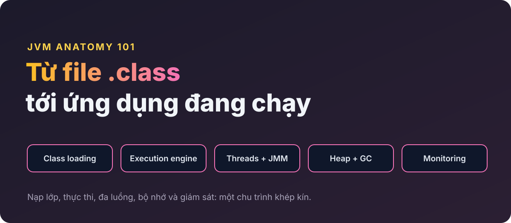
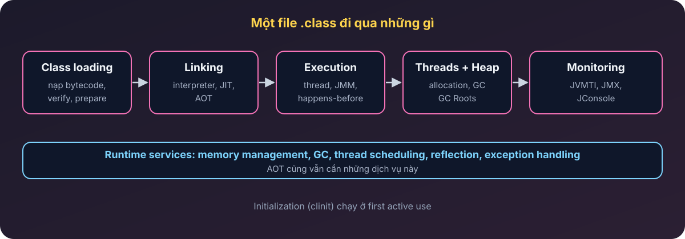

# Tác giả : ChungHA

# JVM Anatomy 101: một file .class đi qua những bước nào để thành ứng dụng đang chạy



Một file `.class` đi qua những bước nào để trở thành ứng dụng đang chạy? Muốn trả lời trọn vẹn, backend engineer cần nắm cả một chu trình khép kín giữa các phân hệ của JVM:

**classloading / linking / initialization → execution engine → threads / allocation / GC → monitoring**

Bài này mình viết dựa trên bài giảng [JVM Anatomy 101](https://www.youtube.com/watch?v=BeMi8K0AFAc) do JetBrains xuất bản năm 2023. Diễn giả là Nikita Lipsky, kỹ sư từng tham gia phát triển Excelsior JET, và ông đi theo các chuẩn mực của Java Virtual Machine Specification. Mình đi lần lượt qua 6 phần.



## 1. Nạp lớp: bản sắc của một kiểu dữ liệu

**Classloading Engine** nhận mảng byte từ file `.class` và tạo ra biểu diễn của kiểu dữ liệu đó trong bộ nhớ runtime.

Điểm hay bị hiểu sai: bản sắc của một class **không chỉ là tên package + tên class**. Nó được xác định bởi một cặp:

> **[Binary Name + Defining ClassLoader]**

Nếu hai defining classloader khác nhau cùng nạp hai file bytecode có binary name giống hệt nhau, JVM vẫn coi đó là **hai type riêng biệt**, nằm trong hai namespace riêng. Hệ quả:

- Object của hai class này **không cast được** sang nhau (ném `ClassCastException` dù tên giống hệt).
- Chúng **không dùng chung static field**, dù chạy trong cùng một process.

Đây là lý do mấy lỗi kiểu "class `Foo` không cast được sang chính `Foo`" xuất hiện trong hệ thống plugin, application server hay hot reload: hai ClassLoader đã nạp `Foo` hai lần.

### Bổ sung: parent delegation và cách tự tái hiện lỗi

> Phần này là mình bổ sung, không nằm trong bài giảng.

Mặc định JVM có một chuỗi ClassLoader: **bootstrap** (class lõi của JDK), **platform**, rồi **application** (classpath của bạn). Khi một loader được yêu cầu nạp class, nó thường **hỏi loader cha trước** (parent delegation), chỉ tự nạp khi cha không có. Cơ chế này giúp `java.lang.String` luôn chỉ có một bản.

Nhưng nếu bạn tạo loader riêng (plugin, application server, hot reload) và các loader đó tự nạp class từ cùng một nguồn, bạn sẽ có hai bản `Class` khác nhau. Đoạn code dưới đây tái hiện đúng điều này:

```java
import java.net.*;

public class Demo {
    public static int counter;

    public static void main(String[] args) throws Exception {
        URL url = Demo.class.getProtectionDomain().getCodeSource().getLocation();

        // parent = null: bỏ qua application classloader, tự nạp Demo từ cùng đường dẫn
        ClassLoader l1 = new URLClassLoader(new URL[]{url}, null);
        ClassLoader l2 = new URLClassLoader(new URL[]{url}, null);

        Class<?> c1 = l1.loadClass("Demo");
        Class<?> c2 = l2.loadClass("Demo");

        System.out.println(c1 == c2);         // false
        System.out.println(c1 == Demo.class); // false

        // static field không dùng chung
        c1.getField("counter").setInt(null, 42);
        System.out.println(c2.getField("counter").getInt(null)); // 0
        System.out.println(Demo.counter);                        // 0

        Object o = c1.getDeclaredConstructor().newInstance();
        Demo d = (Demo) o; // ClassCastException
    }
}
```

Biên dịch bằng `javac Demo.java` rồi chạy `java Demo`, kết quả (mình đã chạy thử):

```
false
false
0
0
Exception in thread "main" java.lang.ClassCastException: class Demo cannot be cast to class Demo
(Demo is in unnamed module of loader java.net.URLClassLoader @...; Demo is in unnamed module of loader 'app')
```

Để ý thông báo lỗi: nó nói rõ hai `Demo` thuộc **hai loader khác nhau**. Gặp lỗi kiểu này, cứ tìm xem class đó bị nạp bởi loader nào, thường thêm `-verbose:class` (hoặc `-Xlog:class+load`) là thấy.

## 2. Method frame, Verification và thời điểm Initialization

Khi một method chạy, JVM cấp một **method frame** trên stack của thread đó. Frame chứa **local variables array** và **operand stack** dùng riêng cho lượt gọi này.

Sau khi nạp, class đi qua giai đoạn **linking** gồm 3 bước:

1. **Verification:** kiểm tra bytecode.
2. **Preparation:** cấp bộ nhớ và gán giá trị mặc định cho static field.
3. **Resolution:** phân giải các symbolic reference. Bước này có thể làm lười, tức là chỉ khi code thực sự chạm tới.

### Ví dụ verification fail

Quy tắc an toàn của verification đòi hỏi **stack height** của operand stack tại mỗi điểm hội tụ của luồng điều khiển phải nhất quán, và các type phải tương thích.

Nikita lấy ví dụ một method: push hai số nguyên lên stack, dùng lệnh cộng để lấy ra hai số và trả về một kết quả, rồi **jump ngược** về index ban đầu. Tại index đầu tiên đó:

- Khi luồng đi vào từ đầu method, stack height là **0**.
- Khi luồng nhảy ngược từ lệnh cộng quay lại, stack height là **1**.

Hai đường vào cùng một điểm mà stack height khác nhau, nên verification thất bại với **`VerifyError`** ngay ở linking. Toàn bộ bytecode của class đó **không được chạy**.

### Initialization

Chỉ sau khi vượt qua kiểm tra, quá trình **initialization** (chạy khối `<clinit>`) mới được kích hoạt, và nó xảy ra ở lần **first active use**, ví dụ:

- Tạo object bằng `new`.
- Truy cập một static field không phải compile-time constant.

## 3. Execution Engine: Interpreter, JIT, AOT

**Execution engine** biến bytecode thành thao tác phần cứng, qua ba cơ chế phối hợp:

- **Interpreter:** thông dịch từng chỉ thị bytecode. Phổ biến là **Template Interpreter**, ánh xạ mỗi opcode sang một đoạn machine code mẫu của CPU để chạy ngay.
- **JIT Compiler:** biên dịch **hot code** thành native code ngay lúc ứng dụng đang chạy, dựa trên dữ liệu profiling. Đây là một trade-off: tốn thời gian cho việc tối ưu, đổi lại sinh được code tối ưu hơn cho CPU.
- **AOT Compiler:** biên dịch bytecode sang native code **trước khi chạy**, phạm vi biên dịch tuỳ implementation.

Từ kinh nghiệm làm Excelsior JET, Nikita nhấn mạnh một điều dễ bị bỏ qua: **dùng AOT không có nghĩa là hết runtime**. Ứng dụng vẫn cần runtime để cung cấp memory management, garbage collection, thread scheduling, reflection, exception handling và monitoring.

### Bổ sung: tiered compilation và deoptimization

> Phần này là mình bổ sung, không nằm trong bài giảng.

HotSpot không chọn một trong hai giữa interpreter và JIT mà dùng **tiered compilation**: code chạy ở interpreter trước, vừa chạy vừa thu profile. Method nóng lên thì được **C1** biên dịch nhanh (tối ưu nhẹ), và nếu vẫn nóng thì **C2** biên dịch lại với tối ưu mạnh dựa trên profile. Vì vậy app thường **chậm lúc mới khởi động rồi nhanh dần** (warm-up), và benchmark ngắn hay cho số liệu sai.

JIT còn tối ưu theo giả định (ví dụ "chỗ này chỉ có một implementation được gọi"). Khi giả định sai, JVM **deoptimize**, quay về code ít tối ưu hơn rồi biên dịch lại. Muốn quan sát, bật `-XX:+PrintCompilation` để xem method nào được compile, ở tier nào, và khi nào bị "made not entrant".

## 4. Đa luồng và quan hệ happens-before

Ở tầng thread:

- **Platform thread** truyền thống ánh xạ **1:1** với một thread của hệ điều hành.
- **Virtual thread** (bài giảng nhắc từ Java 21) do chính JVM quản lý, chạy nhẹ nhàng trên một số thread nền của hệ thống, giúp tăng khả năng mở rộng.

Khi nhiều thread thao tác trên shared memory mà không có chỉ dẫn đồng bộ, CPU và compiler **được phép reorder** các thao tác đọc/ghi. Ví dụ kinh điển:

```java
// Thread 1
Shared.data = getData();   // ghi thường
ready = true;              // ghi volatile

// Thread 2
if (ready) {               // đọc volatile, thấy true
    use(Shared.data);      // chắc chắn thấy data ở trên
}
```

Việc ghi biến `volatile` ở Thread 1 kết hợp với việc Thread 2 đọc thấy `ready == true` thiết lập một quan hệ **happens-before** theo Java Memory Model. Nhờ đó Thread 2 được đảm bảo nhìn thấy toàn bộ dữ liệu ghi trước đó, đúng thứ tự. Bỏ `volatile` đi là bạn không còn guarantee nào.

### Bổ sung: virtual thread và chuyện pinning

> Phần này là mình bổ sung, không nằm trong bài giảng.

Virtual thread chạy trên một số **carrier thread**. Khi virtual thread block (I/O, lock của `java.util.concurrent`...), nó được gỡ khỏi carrier để carrier chạy việc khác. Nhưng có trường hợp virtual thread bị **pinned**, tức là dính chặt vào carrier và block luôn carrier đó. Trường hợp điển hình là block bên trong khối `synchronized` ở Java 21 (JDK 24 đã giảm đáng kể vấn đề này) hoặc khi đang ở trong native frame. Pin nhiều thì mất lợi thế mở rộng. Ở Java 21, có thể thêm `-Djdk.tracePinnedThreads` để xem chỗ nào bị pin, và với code mới, ưu tiên `ReentrantLock` thay cho `synchronized` ở những đoạn có block lâu.

## 5. Heap, GC Roots và cơ chế dọn rác

### Cấp phát

Toán tử `new` là mô hình khái niệm của JVM để tạo object trên **Java Heap** dùng chung. Trong các triển khai thực tế phổ biến, tốc độ cấp phát rất cao nhờ:

- **Bump-the-pointer:** chỉ cần dịch con trỏ tuần tự trong khối nhớ trống.
- **TLAB (Thread-Local Allocation Buffer):** mỗi thread có một vùng đệm riêng, cấp phát bên trong vùng đó không phải tranh chấp lock toàn cục.

### Object nào còn sống

GC xác định object sống qua đồ thị **reachability**. Các **GC Roots** mà bài giảng nêu gồm:

- **Static field** của các class đã nạp.
- **Reference còn sống trong method frame** trên stack của mọi thread (cả local variables array lẫn operand stack).
- **JNI reference** từ native code đang giữ object không bị giải phóng.

Object nào không với tới được từ GC Roots đều là rác. Kể cả một cụm object tham chiếu vòng tròn lẫn nhau (**reference cycle**), nếu bị cô lập khỏi GC Roots thì vẫn thu gom được an toàn. Đây là điểm khác với reference counting.

### Parallel và concurrent

- **Parallel:** nhiều GC thread cùng dọn **trong lúc dừng** ứng dụng.
- **Concurrent:** một phần công việc thu gom chạy **song song** với thread ứng dụng.

Chia pha thế nào và thời gian **Stop-The-World (STW)** bao lâu là do thuật toán của từng collector quyết định.

### Bổ sung: chọn collector là chọn trade-off

> Phần này là mình bổ sung, không nằm trong bài giảng. Chi tiết tuỳ phiên bản JDK, nên kiểm tra lại với bản bạn đang dùng.

- **Parallel GC:** tối ưu **throughput**, chấp nhận pause dài hơn. Hợp batch job.
- **G1:** collector mặc định từ Java 9, cân bằng giữa throughput và pause, chia heap thành các region, có thể đặt mục tiêu pause bằng `-XX:MaxGCPauseMillis` (là mục tiêu chứ không phải cam kết).
- **ZGC và Shenandoah:** làm phần lớn việc **concurrent**, pause rất ngắn và ít phụ thuộc kích thước heap, đổi lại tốn thêm CPU và bộ nhớ. Hợp service nhạy với latency. Shenandoah có trong các bản OpenJDK build, nhưng không phải bản JDK nào cũng đi kèm.

Không có collector "tốt nhất", chỉ có collector hợp với SLO của bạn. Hãy đo bằng `-Xlog:gc` trước khi đổi.

## 6. Metadata và giao diện giám sát

Ngoài class metadata phục vụ Reflection và dynamic invocation, JVM mở hai cổng chuẩn để quan sát:

- **JVM Tool Interface (JVMTI):** giao diện cấp thấp cho **debugger** và **profiler** gắn thẳng vào process đang chạy.
- **Java Management Extensions (JMX / MBeans):** cho các công cụ như **JConsole** hay **VisualVM** theo dõi chỉ số thời gian thực: heap, số thread, hoạt động của GC.

## Chốt lại

Hiểu các mắt xích này giúp mình giải thích được đường đi của code và **khoanh vùng sự cố chính xác** thay vì đoán mò. Thấy `ClassCastException` lạ thì nghĩ tới ClassLoader. Thấy `VerifyError` thì nhìn bytecode. Memory cứ tăng thì lần theo GC Roots. Thấy latency giật theo chu kỳ thì xem pause của collector.

### Bảng tra nhanh khi gặp sự cố

| Triệu chứng | Mắt xích nghi ngờ | Công cụ bắt đầu |
|---|---|---|
| `ClassCastException` giữa hai class cùng tên | Defining ClassLoader | `-verbose:class`, `-Xlog:class+load` |
| `VerifyError` khi nạp class | Verification trong linking | `javap -c` để đọc bytecode |
| App chậm lúc mới chạy rồi nhanh dần | Warm-up của JIT | `-XX:+PrintCompilation` |
| Dữ liệu "không thấy" giữa các thread | Thiếu happens-before | `jstack`, review `volatile`/lock |
| Memory tăng liên tục | Reference giữ từ GC Roots | heap dump (`jcmd <pid> GC.heap_dump`), VisualVM |
| Latency giật theo chu kỳ | Pause của GC | `-Xlog:gc`, JFR |
| Throughput thấp dù CPU rảnh | Thread bị block hoặc pinned | `jstack`, JFR, `jdk.tracePinnedThreads` |

Còn anh em, trong hệ thống backend thực tế, mắt xích JVM nào hay buộc team phải đo đạc và quan sát cẩn thận nhất: tranh chấp thread qua shared memory, rò rỉ reference từ GC Roots, hay độ trễ dừng ứng dụng của GC?
